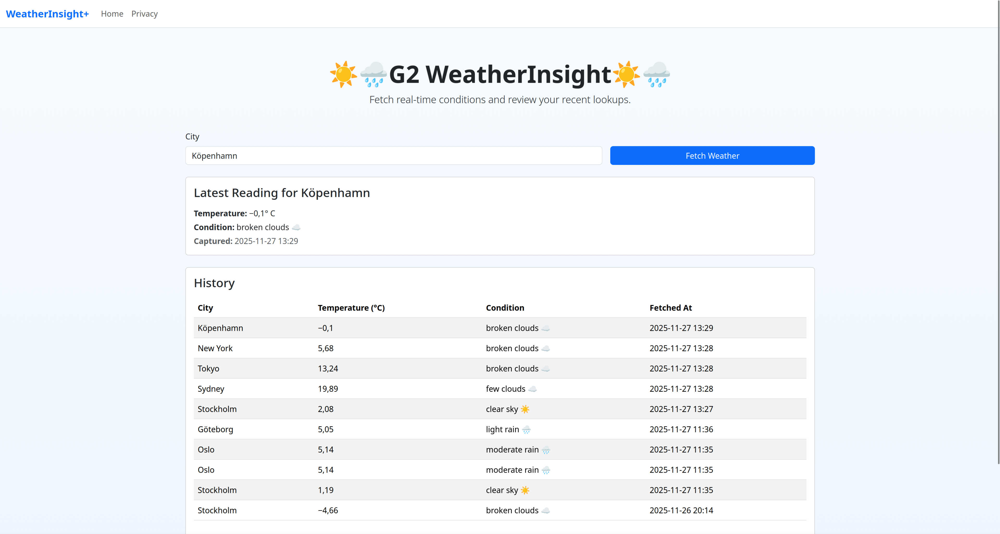
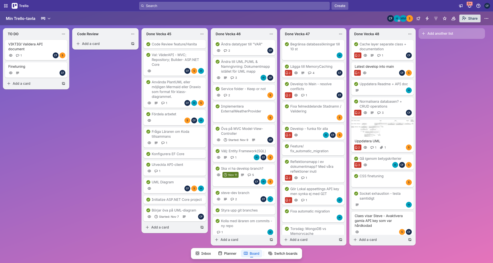

# WeatherInsight

WeatherInsight is an ASP.NET Core MVC application that queries the OpenWeather API for current conditions, saves each lookup in SQLite, and surfaces both the latest reading and the full history through a clean Razor view.

## Features
- Search for weather by city with a simple GET form.
- Persist every response to `weather.db` via EF Core.
- Also cache each response in RAM for 15 minutes.
- Display the most recent reading alongside the full lookup history.
- Typed `HttpClient` integration with graceful handling of unauthorized or malformed responses.

## 🖼️ Screenshots
### Web interface


*The web interface of the application*

## Tech Stack
- .NET 9 / ASP.NET Core MVC
- Entity Framework Core (SQLite provider)
- Typed `HttpClient` + configuration-driven API key management

## Prerequisites
- [.NET 9 SDK](https://dotnet.microsoft.com/download)
- An OpenWeather API key (free tier works for development)

## Setup
1. Clone the repository and move into the solution folder:
   ```bash
   git clone <repo-url>
   cd assignment-oop-adv-Group2
   ```

2. Restore and build:
   ```bash
   dotnet restore WeatherInsight
   dotnet build WeatherInsight
   ```

## Run
```bash
cd WeatherInsight
Linux/MAC: OPENWEATHER_API_KEY="<your-api-key>" dotnet run
Windows: $env:OPENWEATHER_API_KEY="your_api_key" dotnet run
```
Open the URL shown in the console (typically `https://localhost:5160`). Enter a city and submit to fetch the latest weather and update the history table.

## Project Structure (highlights)
- `WeatherInsight/Controllers` – MVC controllers (`HomeController`) that drive the views.
- `WeatherInsight/Services` – `WeatherService` orchestrates API calls and persistence.
- `WeatherInsight/ApiClients` – `WeatherApiClient`, `IWeatherApiClient`, and `WeatherRequestBuilder` Cache the API responses in RAM.
- `WeatherInsight/Data` – `AppDbContext` (EF Core DbContext).
- `WeatherInsight/Models` – Domain entities (`WeatherData`, `ErrorViewModel`).
- `WeatherInsight/Repositories` – Repository abstraction for persistence.
- `WeatherInsight/Views` – Razor UI, especially `Views/Home/Index.cshtml`.

## Additional Documentation
- `API_dokumentation.md` – API endpoints and structure.
- Kanban

*Project kanban group planning and management.*

## Contributing
1. Create a feature branch from `main`.
2. Make your changes (add tests wherever possible).
3. Run `dotnet build` (and tests if added).
4. Submit a pull request referencing the relevant issue.

## Normalization & CRUD
- Agreed upon with instructor that it was not required for this project.

## LINK for API-key
- Open Weather API-Key: https://openweathermap.org/api

## License
This project inherits the license terms in `LICENSE`. Review that file before distributing or modifying the software.
